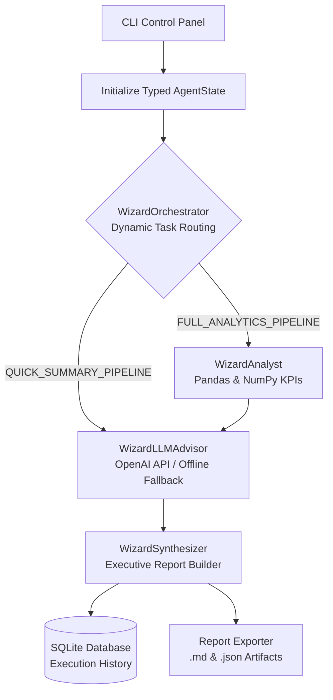

# Wizard OS - Multi-Agent AI Orchestration System


A modular Python-based multi-agent framework designed to orchestrate dynamic workflows, compute analytical KPIs, generate LLM-powered optimization recommendations, persist execution history, and export structured executive reports.

## System Architecture



## Key Features
* **Typed State Management (`AgentState`):** Central dataclass tracking task objectives, dynamic routing decisions, metrics, AI recommendations, and execution traces across nodes.
* **Dynamic Task Routing:** `WizardOrchestrator` inspects incoming requests and routes them either through the `FULL_ANALYTICS_PIPELINE` or the lightweight `QUICK_SUMMARY_PIPELINE`.
* **Data Analytics Engine:** `WizardAnalyst` leverages `pandas` and `numpy` to compute operational KPIs and identify top-performing agents.
* **Generative AI Advisor with Fault Tolerance:** `WizardLLMAdvisor` integrates the OpenAI API (`gpt-4o-mini`) to generate strategic recommendations, automatically falling back to a deterministic rule-based engine when offline or unconfigured.
* **Executive Synthesis & Multi-Format Export:** `WizardSynthesizer` and `WizardExporter` compile execution traces into formatted console reports, Markdown (`.md`), and JSON (`.json`) files.
* **SQLite Persistence & Interactive CLI:** Embedded SQLite database (`database/db.py`) paired with an interactive Control Panel (`interfaces/cli_interface.py`) to run workflows and query execution history.
* **Centralized Logging & Automated Testing:** Standardized file/console logging (`utils/logger.py`), automated unit tests (`tests/test_workflow.py`), and a GitHub Actions CI pipeline.

## Tech Stack
* **Language:** Python 3.10+
* **AI & Data:** OpenAI SDK, Pandas, NumPy
* **Database:** SQLite3
* **Testing & CI/CD:** `unittest` / `pytest`, GitHub Actions
* **Architecture:** Modular Multi-Agent Orchestration (LangGraph-inspired state graph)

## Project Structure
```text
agent-os-workshop/
│
├── .github/workflows/      # Automated GitHub Actions CI test pipeline
├── agents/                 # AgentState, Orchestrator, Analyst, LLM Advisor, Synthesizer
├── database/               # SQLite initialization, persistence, and history queries
├── interfaces/             # Interactive CLI Control Panel
├── tests/                  # Automated unit test suite
├── utils/                  # Centralized logging and Markdown/JSON report exporters
├── .env.example            # Environment variable template for API configuration
├── main.py                 # Core workflow entry point
├── requirements.txt        # Project dependencies
└── README.md               # Project documentation & architecture diagram
```

## Quick Start
1. **Install dependencies:**
   ```bash
   pip install -r requirements.txt
   ```
2. **Configure environment variables (Optional for live LLM insights):**
   ```bash
   cp .env.example .env
   # Add your OPENAI_API_KEY inside .env (runs in offline fallback mode if omitted)
   ```
3. **Run the interactive Control Panel:**
   ```bash
   python main.py
   ```
4. **Run automated unit tests:**
   ```bash
   python -m unittest discover -s tests -v
   ```